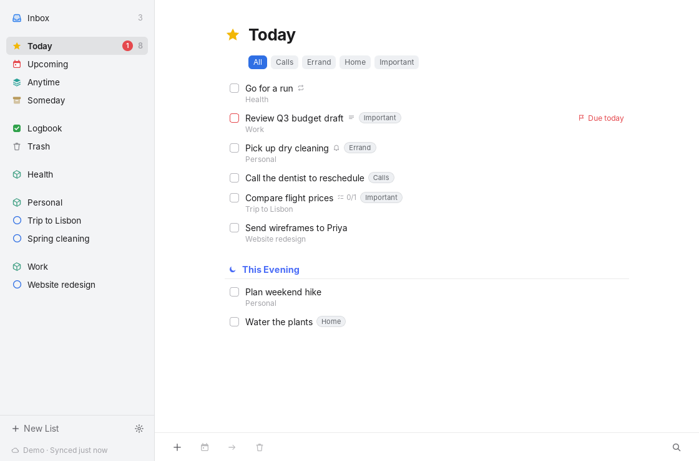
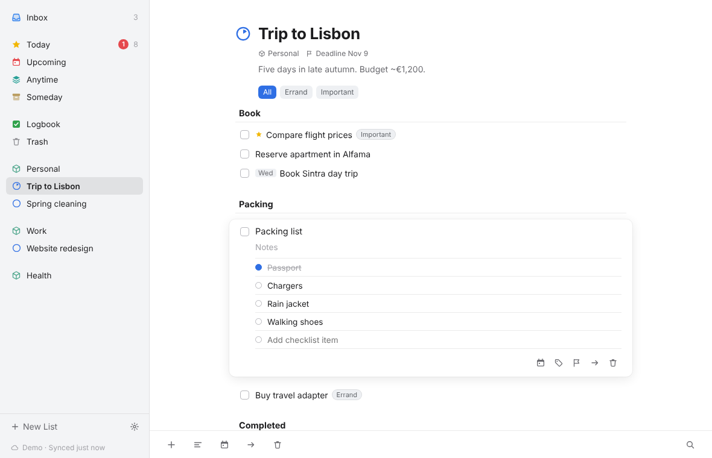
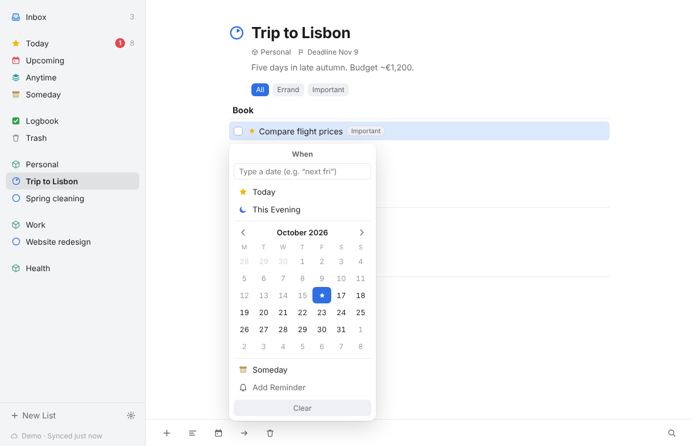
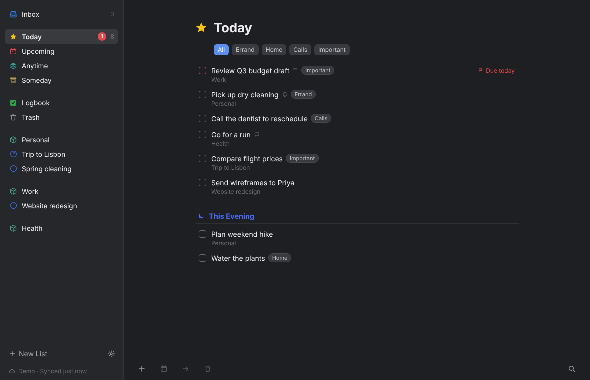

# Cairn

A Windows task manager in the spirit of Things 3, built with Tauri 2, React and
TypeScript. Cairn reads — and, after you opt in, writes — your **Things Cloud**
data, so it can stay in sync with Things on your iPhone without a Mac.

> **Unofficial.** Things Cloud has no public API. Cairn speaks a
> reverse-engineered protocol (ported from
> [things-cloud-mcp](https://github.com/wbopan/things-cloud-mcp) /
> things-cloud-sdk). It starts read-only, and end-to-end sync with a real
> account **has not yet been verified** — see [docs/TESTING.md](docs/TESTING.md).
> Not affiliated with Cultured Code.



| Project with headings and the to-do editor | When picker | Dark mode |
|---|---|---|
|  |  |  |

## Features

* **Things lists:** Inbox, Today (with This Evening), Upcoming (by day, then
  month), Anytime, Someday, Logbook, Trash; areas, projects with headings and
  progress pies, tags with a tag filter bar, Quick Find.
* **Editing:** inline to-do editor with notes, checklists, tags, deadlines,
  reminders and When (Today / This Evening / calendar / Someday, plus typed
  dates like "next fri"). Drag to-dos onto sidebar lists, projects or areas.
* **Quick Entry:** global shortcut (default **Ctrl+Alt+Space**) opens a small
  always-on-top window that understands `Pay rent friday at 9am #Home due oct 31`.
* **Windows integration:** tray icon, close-to-tray, launch at sign-in,
  reminder notifications, single instance, optional Mica sidebar on Windows 11,
  light/dark mode.
* **Things Cloud connector:** local, in-process Rust connector — no hosted
  service, no local server. Offline cache (SQLite), background sync with
  back-off, and visible sync status.
* **Safety:** read-only by default; explicit opt-in for writes and a separate
  one for permanent deletions; field-level conflict detection; uncertain writes
  are journaled, reconciled by reading, and **never retried automatically**.
  Credentials live in Windows Credential Manager.
* **Repeating to-dos** are displayed with a readable rule ("Weekly on Mon,
  Thu"); new occurrences are generated by Things on your iPhone.

## Install

Download the latest `Cairn_*_x64-setup.exe` (or `.msi`) from the
**Windows build** workflow's artifacts on GitHub Actions. The installers are
unsigned, so SmartScreen will ask you to confirm.

On first launch Cairn shows demo data stored only on your PC. Connect your
account in **Settings → Account**.

## Keyboard shortcuts

| Action | Keys | Action | Keys |
|---|---|---|---|
| New to-do | Ctrl+N | Quick Find | Ctrl+F |
| Open / edit selected | Enter | Close editor | Esc |
| Complete | Ctrl+K | Move to Trash | Delete |
| Today / This Evening | Ctrl+T / Ctrl+E | Anytime / Someday | Ctrl+R / Ctrl+O |
| When… | Ctrl+S | Move… | Ctrl+Shift+M |
| Deadline… | Ctrl+Shift+D | Tags… | Ctrl+Shift+T |
| Go to list 1–7 | Ctrl+1 … Ctrl+7 | Sync now | F5 |
| Settings | Ctrl+, | Quick Entry (global) | Ctrl+Alt+Space |

## Develop

Requirements: Node 22+, Rust (stable), and the
[Tauri prerequisites](https://tauri.app/start/prerequisites/) (WebView2 on
Windows).

```powershell
npm ci
npm run dev           # UI only, in a browser, with mock data
npm run tauri dev     # full desktop app (demo account)
npm test              # frontend tests
cargo test --workspace
npm run tauri build   # installers in target/release/bundle/
```

```
crates/things-cloud   Protocol connector: ids, wire format, state replay, HTTP, fake server, read-only CLI
crates/things-sync    SQLite cache, sync engine, write policy, journal, conflicts, demo data
src-tauri             App shell: commands, credentials, tray, shortcut, notifications, autostart
src                   React UI (mock backend for browser dev and tests)
```

## Documentation

* [docs/THINGS_CLOUD_RESEARCH.md](docs/THINGS_CLOUD_RESEARCH.md) — what the
  MCP does, the protocol, authentication, the security review, and the risks
  of relying on an unofficial protocol.
* [docs/ARCHITECTURE.md](docs/ARCHITECTURE.md) — design and safety pipeline.
* [docs/TESTING.md](docs/TESTING.md) — what is verified, and how to test
  safely with a disposable account.
* [SECURITY.md](SECURITY.md) — where secrets are stored and what never leaves your PC.

## License

MIT. See [LICENSE](LICENSE) for attributions.
